<div align="center">

# spiw-bot

**Turn a TikTok, Instagram or X link into the real video, right in the chat you are typing in.**

</div>



<br><br>



## What it does

<table>
<tr>
<td width="33%" valign="top">

**⚡ Instant repeats**

A post seen before is sent as the file itself, at once.

</td>
<td width="33%" valign="top">

**🎞️ Whole posts**

Several photos or videos get ⬅️ ➡️ buttons.

</td>
<td width="33%" valign="top">

**📦 Past 50 MB**

MTProto directly, not the Bot API.

</td>
</tr>
<tr>
<td valign="top">

**🧠 Nothing on disk**

Media only passes through RAM.

</td>
<td valign="top">

**📝 Captions for X**

X posts keep their text.

</td>
<td valign="top">

**📊 `/stats`**

Counts the videos delivered.

</td>
</tr>
</table>

## How it works



<details>
<summary>Step by step</summary>

1. **Inline query.** The link is checked against the platform whitelist and
   canonicalised (short links are followed). The card's id is a hash of the
   post, so nothing else has to be remembered. Telegram reports which message
   was sent only if it has a keyboard, so the card carries one link button
   until the media replaces it.
2. **Delivery.** [cobalt](https://github.com/imputnet/cobalt) resolves the
   post, the media is downloaded into RAM, its headers are read for size and
   duration, and it is uploaded to Telegram once. The message is then edited to
   show it.
3. **Every later request for the same post** reuses the Telegram files: the
   inline query is answered with the file itself, so sending it involves the
   bot no further. The references live in SQLite and survive restarts. If
   Telegram no longer accepts one, the card is offered again and the post is
   uploaded anew.
4. **Paging.** Each ⬅️ ➡️ button carries the post id and the index of the file
   it shows; a press edits the message in one API call. Telegram accepts a
   press only with data that is on a button of that very message, so a button
   cannot be forged to show some other post.

</details>

## Quick start

Build anywhere; the target is a static Linux binary:

```bash
cargo install cargo-zigbuild        # once; needs zig
rustup target add x86_64-unknown-linux-musl
cargo zigbuild --release --target x86_64-unknown-linux-musl
docker build --platform linux/amd64 -t spiw-bot:latest .
docker build --platform linux/amd64 -t spiw-fw:latest fw
```

On the server, next to `docker-compose.yml`:

```bash
cp .env.example .env                # fill in BOT_TOKEN, TG_API_ID, TG_API_HASH, HOST_PUBLIC_IP
cp keys.example.json keys.json      # replace the UUID with your own, lowercase: uuidgen | tr A-Z a-z
# put the same UUID into COBALT_AUTHORIZATION in .env
mkdir -m 700 data && chown 10001 data
chown 10002 keys.json && chmod 400 keys.json
docker compose up -d
```

In @BotFather turn on inline mode (`/setinline`) and set inline feedback to
100% (`/setinlinefeedback`), or the bot is never told that a card was sent.

<details>
<summary>Security model</summary>

- **Jail.** `docker-compose.yml` runs the bot and cobalt in one network
  namespace behind a firewall sidecar ([fw/fw.sh](fw/fw.sh)): no published
  ports, outbound traffic to the public internet only. The host, its private
  networks, other containers and cloud metadata are unreachable. Containers run
  as unprivileged users with no capabilities and a read-only root.
- **Image.** `FROM scratch`: the binary and a CA bundle, nothing to run a
  shell with.
- **Private cobalt.** The instance listens on loopback and requires an API
  key, as its [docs](https://github.com/imputnet/cobalt/blob/main/docs/protect-an-instance.md)
  recommend. Services the bot does not use are disabled.
- **No SSRF.** Every URL that comes from a user or from a cobalt instance goes
  through an HTTP client that refuses private and loopback addresses, also
  after DNS resolution and redirects. API keys are only ever sent back to the
  instance they belong to.
- **Bounded memory.** One global budget caps the media bytes held in RAM, and
  every body read from the network has a size limit.
- `unsafe` is forbidden in the crate.

</details>

<details>
<summary>Configuration</summary>

| Variable | Default | Meaning |
|---|---|---|
| `BOT_TOKEN`, `TG_API_ID`, `TG_API_HASH` | required | Telegram credentials |
| `COBALT_BASE_URL` | required | Our cobalt instance |
| `COBALT_AUTHORIZATION` | none | `Authorization` header for it, e.g. `Api-Key <uuid>` |
| `COBALT_EXTRA_ENDPOINTS` | none | Fallback instances, `url` or `url\|Api-Key <uuid>`, comma separated |
| `DB_PATH` | `data/spiw.sqlite` | SQLite file |
| `INLINE_RESOLVE_TIMEOUT_MS` | `5000` | Time allowed to canonicalise a link or fetch a caption |
| `COBALT_REQUEST_TIMEOUT_MS` | `8000` | Time allowed for one cobalt API call |
| `REHYDRATE_TTL_SECONDS` | `432000` | How long a post stays known after it was last requested |
| `MAX_CONCURRENT_JOBS` | `32` | Posts being fetched at once |
| `MEDIA_BUFFER_BUDGET_BYTES` | 2 GiB | Media bytes held in RAM across all jobs |
| `MAX_MEDIA_ITEM_BYTES` | 2 GiB | Largest single file |
| `LOG_LEVEL` | `info` | `error`, `warn`, `info`, `debug`, `trace` |

User-facing strings are in [resources/messages.json](resources/messages.json)
and are compiled into the binary.

**Other cobalt instances.** Our own instance is always asked first. When it
cannot fetch a post (for example because the platform rate-limits the server's
IP), the bot moves on to `COBALT_EXTRA_ENDPOINTS` in order. An instance that
rejects our credentials is skipped for an hour. Public cobalt instances are
bot-protected and, per cobalt's
[API docs](https://github.com/imputnet/cobalt/blob/main/docs/api.md), not meant
for other projects without their owner's permission. List only instances you
were given access to.

</details>

<details>
<summary>Source layout</summary>

```
src/
├── main.rs     startup, Telegram session, update loop
├── bot.rs      handlers and the delivery pipeline
├── tg.rs       upload and inline-message editing over raw MTProto
├── cobalt.rs   cobalt API client, instance failover, memory budget
├── meta/       link whitelist and canonical URLs per platform, X post text
├── probe.rs    media type, size and duration from container headers
├── net.rs      HTTP clients and the private-address filter
├── db.rs       SQLite: posts, link aliases, stats
└── url.rs, config.rs, model.rs, error.rs
```

</details>

<div align="center">
<br>
<sub>Built on <a href="https://codeberg.org/Lonami/grammers">grammers</a> and <a href="https://github.com/imputnet/cobalt">cobalt</a> · MIT licensed · written in Rust 🦀</sub>
</div>
